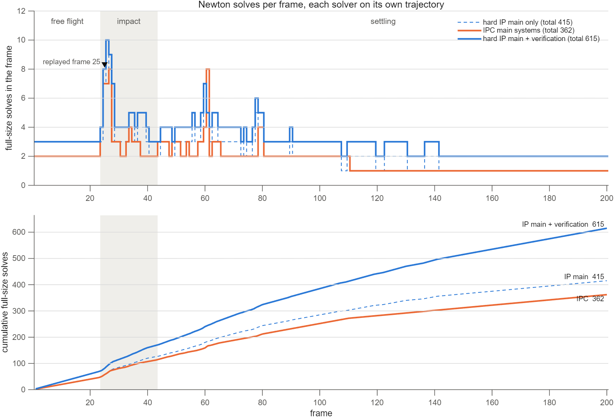
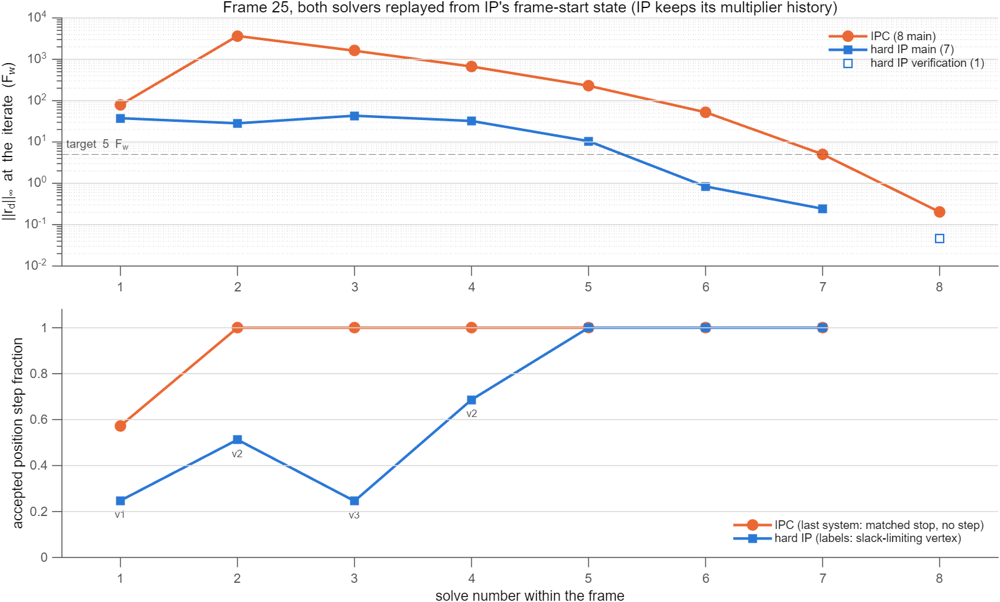

# 2D box drop: hard IP vs IPC — where hard IP's extra Newton solves appear

Standalone MATLAB experiment. Reference (read only): `E:\ZiyanXiong\github\libuipc-ip`. Round 20 was used for discovery, round 21 for the equations and step limits, and round 43's `base` arm for the hard-IP configuration; the exact 3D sources are identified in [reference/README.md](reference/README.md).

All numbers below come from the archived run in `reference/baseline_2026-11-20/results/`; paths are relative to that folder unless stated. The first report, as originally written, is kept unchanged as `reference/baseline_2026-11-20/code/REPORT.md`.

**Reproduce** from the project folder (MATLAB R2025b; about 15 s plus startup; writes a new `runs/run_…` folder):

```
matlab -batch "run_experiment"
```

## How the evidence is checked

Two separate checks; neither substitutes for the other.

- **Archive integrity (byte level).** `reference/baseline_2026-11-20.sha256` lists the SHA-256 of all 54 archived files: the 39 run outputs and the 15 files of the code and report that produced them. `sha256sum -c` (or `tools/verify_reference.m`) shows the archived bytes are unchanged. It says nothing about whether a new run reproduces the numbers.
- **Reruns (numerical).** `tools/compare_to_reference.m` compares a new run's values with the archive:
  - per-frame counts, statuses and returned-state quantities, read from `trajectories.mat`, must be exactly equal;
  - impact-replay and diagnosis values, read from CSV and JSON, must agree to 1e-12 relative.

  A rerun from a clean clone matched in all 27 checks on 2026-11-20.

## What the traces establish

### 1. Newton solves, each solver on its own trajectory

All 200 frames of both solvers qualify (`phase_totals.csv`, `frames_*.csv`).

| phase | frames | IP main | IP verification | IP total | IPC main = total | IP − IPC, main | IP − IPC, total |
|---|---|---|---|---|---|---|---|
| free flight | 1–23 | 46 | 23 | 69 | 46 | 0 | +23 |
| impact | 24–43 | **80** | 20 | **100** | **67** | **+13** | +33 |
| settling | 44–200 | 289 | 157 | 446 | 249 | **+40** | +197 |
| **total** | 1–200 | **415** | 200 | **615** | **362** | +53 | +253 |

The 200 verification systems (one per IP frame) account for 200 of the 253-solve total difference. The 13 extra impact main solves split by frame range as follows:

| impact frames | IP main | IPC main | IP − IPC |
|---|---|---|---|
| 24 | 3 | 4 | −1 |
| 25–28 | 30 | 25 | +5 |
| 29–43 | 47 | 38 | +9 |
| 24–43 | 80 | 67 | **+13** |

These, and the +40 in settling, are **observed count differences** between two trajectories. The experiment did not isolate how many of them the shortened steps (clipping) caused.

### 2. Shortened steps during impact

Hard IP took **20 shortened, accepted position steps** (fraction < 1) in frames 24–43, all bound by slack positivity (`iters_ip.csv`). IPC took 3, the first steps of frames 25–27, which its CCD cut to 0.555–0.588.

| frame | shortened IP steps | first Newton step (k = 0) | smallest accepted fraction in the frame | later shortened steps |
|---|---|---|---|---|
| 25 | 4 | **0.2474** | 0.2456 (k = 2) | 0.5126, 0.2456, 0.6865 (all τ̂ = 1) |
| 26 | 7 | **0.0771** | 0.0771 (k = 0) | 0.2482, 0.2118, 0.3807, 0.3790, 0.8977 (τ̂ = 1); 0.6128 (final level) |
| 27 | 6 | **0.0966** | 0.0966 (k = 0) | 0.2595, 0.2121, 0.4195, 0.5067 (τ̂ = 1); 0.8117 (final level) |
| 28 | 2 | **0.0800** | 0.0800 (k = 0) | 0.4481 (τ̂ = 1) |
| 39 | 1 | 1 (full step) | 0.9808 (k = 1, final level, v17) | — |

All other impact-frame steps were full steps.

**The first Newton step of frames 25–28** (k = 0, τ̂ = 1) was limited by a row carried from the previous frame with sλ/μ ≈ 0.05, so its condensed stiffness λ/s was about 5 % of μ/s² (`impact_sweep_first_limiting_iterates.csv`):

| frame | limiting vertex | g / d̂ | sλ/μ | predicted normal motion / gap |
|---|---|---|---|---|
| 25 | v1 (corner) | 0.601 | 0.050 | −4.02 |
| 26 | v5 | 0.095 | 0.056 | −12.9 |
| 27 | v11 | 0.124 | 0.050 | −10.3 |
| 28 | v16 | 0.020 | 0.050 | −12.4 |

At those first steps, the multiplier bound, the element bound and merit backtracking did not bind, and the early ground scan after the accept found every gap positive. The direction is a coupled motion, as in round 21: rows already pressed below 10⁻³ d̂ are predicted to open by 16–19 times their gaps, the few at 1–3·10⁻³ d̂ by 7–17 times, while a far-side row closes.

### 3. The first step at the same state with centered multipliers

This is one diagnostic direction per frame: positions, rows, slacks and μ are unchanged, and only λ_i := μ/s_i. It goes through the solver's own step rules. Frames 25–28 use their first Newton step; frame 39 uses its first shortened step (k = 1).

| frame | centered: permitted first step (limiting vertex) | centered: motion / gap of the §2 vertex | IPC at the same geometry: motion / gap of that vertex; accepted step |
|---|---|---|---|
| 25 | 0.258 (v1) | −3.86 | −0.14; 0.573 (CCD on v2) |
| 26 | 0.128 (v5) | −7.77 | +0.69; 0.625 (CCD on v8) |
| 27 | 0.135 (v11) | −7.35 | +0.66; 0.638 (CCD on v14) |
| 28 | **0.512 (v17)** | −1.09 | +0.80; 1.0 |
| 39 (k = 1) | 0.190 (v17) | −5.23 | +0.76; 1.0 |

- **Frames 25–28:** centering increased the permitted first step in every frame. In frame 28 it rose from 0.080 to 0.512, and a different vertex, v17, still limited the step.
- **Frame 39:** centering shortened the step from 0.9808 to 0.190; there the carried multipliers were above central (sλ/μ = 16.9).

### 4. Independently centered restarts of the impact frames

Each of the 20 impact frames was restarted from IP's own saved frame-start state with every multiplier started centrally (history ignored). These are independent single-frame restarts, not a trajectory, and a different experiment from the single direction in §3.
- **Main solves:** **94**, against 80 with carried multipliers; verification was 20 in both.
- **Frames 25–28:** 8, 10, 9 and 5 main solves, against 7, 9, 8 and 6.

### 5. Own trajectory vs replay at the same IP state

Every replay at a solver's own frame-start state reproduces that trajectory frame exactly (20/20 IP, 20/20 IPC in a rerun's `impact_replay_agreement.csv`).

IPC needed 7, 7, 8 and 3 main solves in frames 25–28 on its own trajectory, but 8, 15, 16 and 16 when replayed at IP's frame-start states. IP's pressed rows sit at g ≈ 3·10⁻⁴–3·10⁻³ d̂ there, and IPC's barrier force at those gaps is very large: r_d ≈ 2.2·10⁶ F_w at frame 26's first iterate. Such replays measure IPC at states it never reaches on its own; they are not like-for-like counts.

### 6. Forces at the first-step limiting vertex

| | frame 25 | frame 26 | frame 27 | frame 28 |
|---|---|---|---|---|
| IP's effective contact force μ/s (F_w) | 1.66 | 10.6 | 8.1 | 49.6 |
| downward non-contact push, −∂E_mech/∂y (F_w) | 9.5 | 17.0 | 17.8 | 8.7 |

The non-contact push combines momentum and elasticity. For comparison, IPC's barrier force at the same gaps is 88–31,500 F_w.

### 7. Assembly identities at s = g

From `replay_frame0NN.json`, under `assembly`:
- K − H₀ is diagonal with λ_i/s_i on the rows' normal DOFs (relative error ≤ 1.1e-13).
- The right-hand-side contact term is −μ/s_i (≤ 5e-16).
- An unreduced (dx, ds, dλ) KKT solve reproduces the condensed direction (≤ 3e-15).
- The physical force balance uses the actual λ: at frame 26, r_d = 39.3 F_w with λ, against 1,731 F_w with μ/s.

## What remains open

- **The cause of the +13 impact and +40 settling main solves** (§1).
  - In frames 29–43, IP's steps were full except frame 39's single shortened step (§2). Each frame used zero to two systems at τ̂ = 1, then two or three at the final level; IPC used two to four per frame.
  - Whether the two-level barrier schedule or the stopping rules explain the difference was not tested.
  - Settling was not investigated.
- **Whether the shortened steps cost solves.**
  - The only counterfactual run, the centered restarts (§4), cost more. It changes every multiplier, not just the limiting ones.
  - No experiment has removed the short steps while holding everything else fixed.
- **Other multiplier choices in frames 25–27.**
  - With carried and with centered multipliers, the first step stayed short (§2, §3), and μ/s was below the non-contact push (§6).
  - At s = g the right-hand side's contact force is μ/s whatever λ is, but the stiffness λ/s is not.
  - A stiffer choice (λ > μ/s, toward IPC's stiffness at those gaps) was not tested.
- **Frame 28.** Centering removed most of the first-step limit at v16 (§3), but the step stayed limited at v17. Whether a longer first step would lower the frame's solve count was not tested.
- **Transfer to 3D.** See the README section on 2D-to-3D differences: contact topology, units, material, κ, linear solver, and what was not ported.

## Scene and shared numerics

| item | value |
|---|---|
| Body | 0.4 × 0.4 m elastic box, 16 × 16 cells, 289 vertices, 512 triangles (17 bottom vertices), alternating diagonals |
| Initial state | tilted 10° counter-clockwise, at rest, lowest vertex (the corner, v1) 0.3 m above the ground line y = 0; frictionless |
| Material | rest-stable 2D stable neo-Hookean Ψ = μ/2(‖F‖² − 2) − μ(J − 1) + λ/2(J − 1)²; E = 1e5 Pa, ν = 0.4 (plane-strain Lamé μ = 3.57e4, λ = 1.43e5); ρ = 1e3 kg/m³; lumped masses |
| Time | implicit Euler, dt = 0.01 s, 200 frames; x̃ = xₙ + dt vₙ + dt² g, g = −9.8 |
| Shared code | mesh, masses, `mech_eval` (energy, gradient, per-element PSD-projected Hessian), `elem_check` (exact first-inversion time; trials must keep every det > 0), `shared_solve` (sparse Cholesky), inertial prediction |
| Tolerances | d̂ = 0.01 m; tol_disp = velocity_tol·dt = 5e-4 m; force-balance target 5 F_w; ≤ 8 line-search trials; budget 256 main systems per frame |
| IPC κ | native scene-adaptive corridor (`global_contact_manager.cu`) evaluated in 2D: [1.1e6, 1.1e8]; the scene default 1e9 is clamped to κ = 1.1e8, κ·dt² = 1.1e4 |

**2D normalization.** The box is a plane-strain slab of unit depth, so masses, energies and forces are per metre of depth. The solver energy is ½‖x − x̃‖²_M + dt²Ψ_el (+ κdt²ΣB for IPC), and its gradient has the unit force·dt². **F_w** = mean vertex mass·|g|·dt² = 5.43e-4 is one vertex's weight in that unit; the whole body weighs 289 F_w.
- Force tolerances in F_w are per-vertex-weight units, so "5 F_w" means the same in 2D as in the 3D reference.
- The barrier has unit F_w·L with L = d̂: τ̂ = τ/(F_w L), τ₀ = 1, τ_final = tol_disp/L = 0.05.
- κ comes from the corridor and is proportional to the mean vertex mass, so κdt²/F_w does not depend on the depth convention.
- tol_disp is an absolute length for both solvers.

Everything resolved is in `settings.json`.

## Solvers

**IPC** (`src/ipc_solve_frame.m`):
- **Barrier:** the native log² barrier κdt²(D − d̂²)² log²(D/d̂²) with D = g² (`KappaBarrierLog2`), active for g < d̂. Its gradient and unprojected Hessian are evaluated at every iterate and every line-search trial.
- **Step:** half-plane CCD (η = 0.1). For a vertex closing on the ground, the step may close at most 90 % of its current gap, leaving at least 10 %. Then the shared element bound, and halving on the incremental energy (E ≤ E₀). CFL is off.
- **Stop (round 43 matched stop):** native |dx|∞ ≤ tol at the current state, plus at that state r_d ≤ 5 F_w with IPC's own law, full-correction CCD ≥ 1, valid elements and positive gaps. The state is returned without the terminal step.
- **Derivative check** (`derivative_checks_barrier.csv`): at gaps of 0.02 to 0.99 d̂, dB/dD, d²B/dD² and the assembled vertex gradient and Hessian agree with central differences to 1e-11–1e-8 (relative). The normal stiffness is positive over the whole band.

**Hard IP, round-43 `base`** (`src/ip_solve_frame.m`; arm H + signed schedule + zero-CCD ground advance + early discovery):
- **Rows:** g_i − s_i = 0, s_iλ_i = μ, ∇E − Jᵀλ = 0, condensed to (H₀ + Jᵀdiag(λ/s)J)dx = −(∇E − Jᵀ(μ/s) + Jᵀdiag(λ/s)(g − s)).
- **Frame start:** τ̂ = 1, s = g, central λ = μ/s. Multipliers are carried from the preceding accepted frame by vertex identity (all 2,645 frame-start rows of the run were carried). The first barrier decrease goes directly to τ̂ = 0.05 when E_τ ≤ 10τ̂.
- **Step:** slack and multiplier fractions to the boundary (η = 0.995), update B, the split rule at τ̂ = 1 (5 uses), the element bound, s̃ = max(s + α ds, g(x̃)), and Armijo (with its round-off rule) on F − τΣlog(s̃/d̂) + νΣ|g − s̃| with ν = 1.1 max|λ + dλ|.
- **Shared rules:** these step rules live in `src/ip_step_proposal.m`, `ip_line_search.m`, `ip_armijo.m`, `ip_merit_slope.m` and `ip_step_limiter.m`, used by both the solver and the diagnostics. A rerun after moving them there matched all 615 archived IP iterations exactly in every compared per-iteration quantity.
- **Contacts:** no CCD. After every accepted step, all 289 vertex gaps are scanned (215 scans). In-band vertices become central rows (38 early rows). A nonpositive gap would trigger the halving ground advance; this never happened.
- **Stop:** the terminal update, then a fresh verification (one verification system): r_d with the actual λ, the correction, |g − s|, centrality, sign of s and λ, unresolved contacts, gaps and elements.
- **Not ported:** the element-redirect step (its trigger never armed; the element bound never limited a step), self contact, PCG (exact solves instead), and the rounding-certified determinant test (det > 0 instead). The reduced first step, P70 buffer and logarithmic gap update are left for future work.

**Failed frames.** A frame that fails qualification ends its trajectory. Its diagnostics are kept, and position, velocity, multiplier history and time stay at the last qualified frame. An incomplete trajectory is excluded from performance comparisons (`src/run_trajectory.m`, `src/compare_performance.m`, `tests/test_failure_handling.m`). No frame failed in this run.

## Matched accuracy (all 200 frames of both solvers qualify)

| at the returned states | hard IP | IPC |
|---|---|---|
| max ‖r_d‖∞ (own contact law; target 5 F_w) | 0.12 F_w (actual λ) | 4.91 F_w |
| max correction / tol_disp | 0.14 (verification system) | 0.91 (last main system) |
| run minimum vertex-to-ground gap (both on frame 27, during impact) | 2.83 µm (2.83e-4 d̂) | 5.14 mm (0.514 d̂) |
| frame-200 gap (minimum vertex-to-ground gap at the endpoint) | 25.98 µm (2.60e-3 d̂) | 7.35 mm (0.735 d̂) |
| smallest det F / rest | 0.850 | 0.848 |
| IP only | max \|g − s\| = 0; max \|sλ/μ − 1\| = 1.19 (bound: 10τ_final, i.e. ≤ 10); unresolved contacts 0 | 20 native stops rejected by the matched check |

One IP system is counted as discarded. In frame 2 (free flight), the terminal correction was 1.6e-14 tol and the merit change was below rounding, so all 8 trials were rejected; the unchanged state then passed verification.



## Frame 25 in detail

**Selection.** The rule was fixed before the run: the first impact frame with an accepted IP fraction ≤ 0.25. Frame 25 qualifies through its smallest accepted fraction, 0.2456 at k = 2, close to the threshold. The analysis uses its first shortened step: k = 0, fraction 0.2474, one row, τ̂ = 1. The impact-frame results in §2–§6 do not depend on this choice.

**The limiting row at that step:** v1, the corner, carried from frame 24 (g, sλ/μ and the predicted motion are in §2's first-step table):

| quantity | value |
|---|---|
| λ | 0.0832 F_w |
| μ | 1 F_w L |
| λ/s | 0.138 F_w/d̂ = 5 % of μ/s² (2.77); 0.036 of the vertex mass |
| IPC at the same gap | force 88 F_w, stiffness 704 F_w/d̂ |

| restriction (from the raw direction) | value |
|---|---|
| slack positivity | **0.2474** (0.995 × the raw crossing 0.2486, v1), binding |
| multiplier positivity | 1 (no multiplier decreases) |
| element validity | none (no inversion on (0, 1]) |
| ground safety | exact crossing 0.2486, the same vertex; the early scan after the accept found every gap positive |
| merit backtracking | first trial accepted |

**Diagnostic work, counted apart from simulation.**
- **Diagnostic solves:** 4 per diagnosed frame (the recomputed direction, the KKT check, the centered direction, and IPC at the same geometry), 20 in the sweep.
- **Same-state frame replays:** 485 full-size solves in the archived run. A new run also replays IPC at its own frame-start states for the agreement check, for 552.



Supplementary frame 26: `plots/impact_frame_26_residual_and_step.png`.

## Files

See [README.md](README.md) for the layout, the commands and the expected values.
- **Archived run:** `reference/baseline_2026-11-20/results/` (`trajectories.mat`, `settings.json`, `frames_*.csv`, `iters_*.csv`, `phase_totals.csv`, `impact_sweep_first_limiting_iterates.csv`, `replay_frame0{25,26,27,28,39}*`, `summary.{md,json}`, `plots/`, `run_log.txt`).
- **A new run:** also writes `impact_replay_agreement.csv`, `performance_comparison.json`, `run_info.json` and, when a frame fails, `failure_<solver>.json`.
